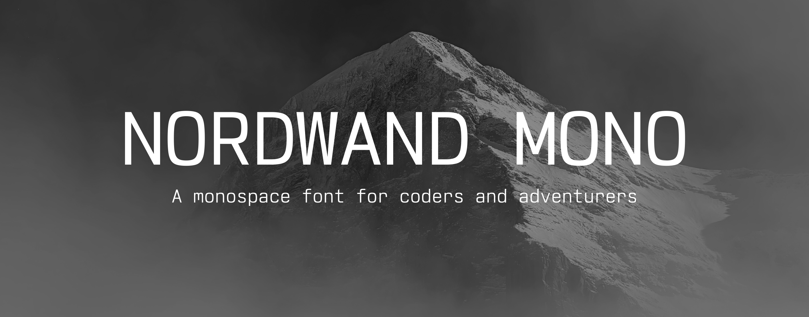
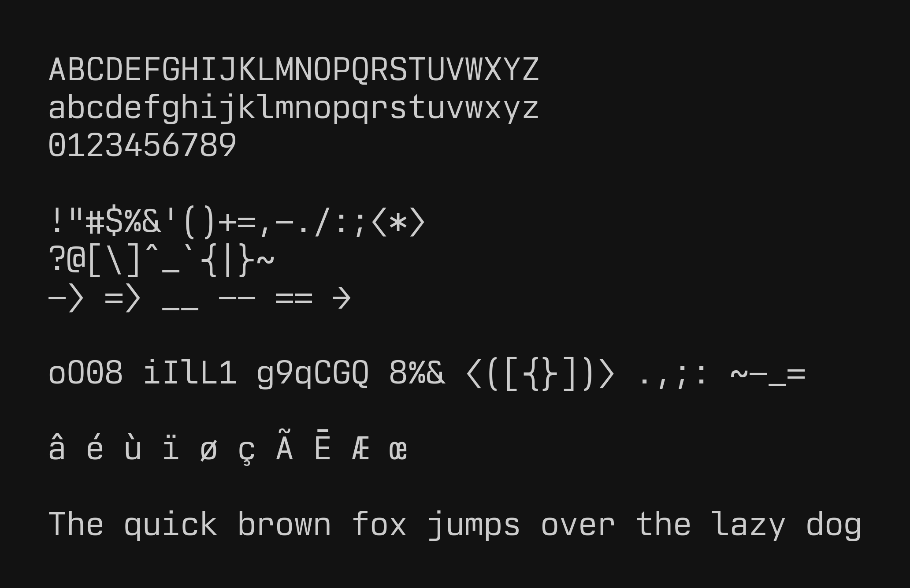
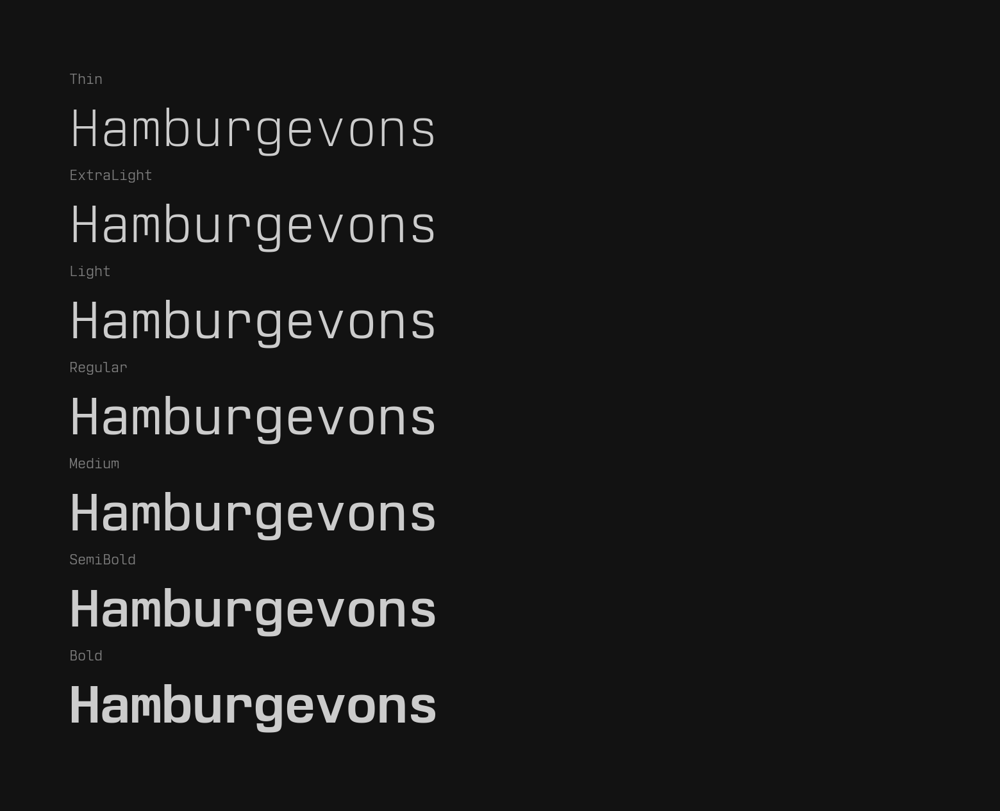
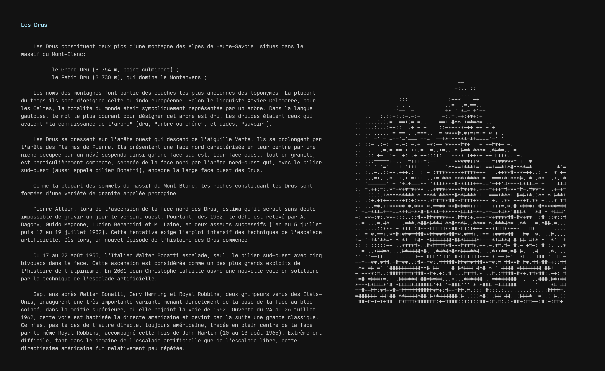
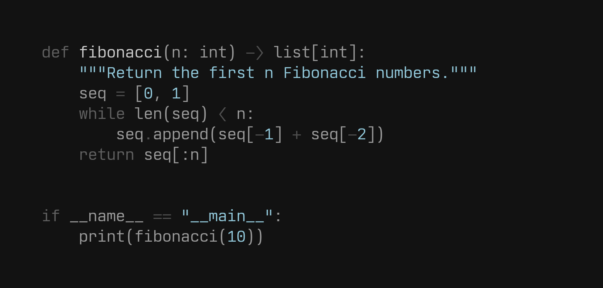
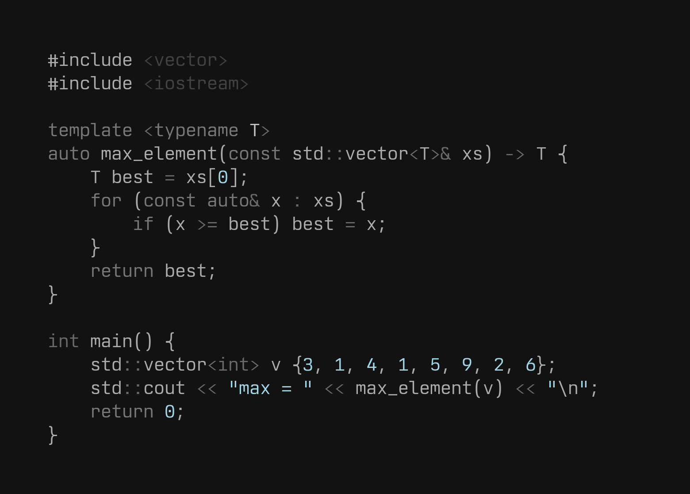
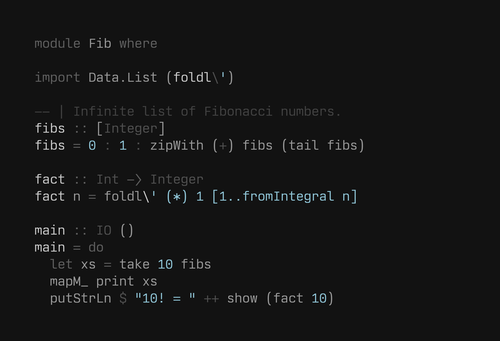
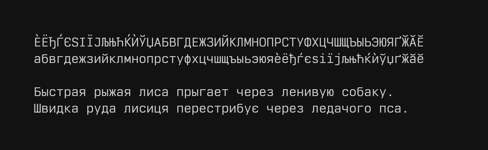

A compact neo-grotesk font designed for coding.

## Philosophy

I'm very passionate about the font I am using for my terminal and overall neovim experience, and I couldn't find the "perfect" font. So I decided to design one from scratch using python. This font aims to bring some elements from the all time classic "Univers" font into the proportions of the "JetBrains Mono" font. The name "Nordwand" is a reference to switzerland and its iconic typography – bringing it into the stiff and cold atmosphere of the swiss north faces.

Amongst the inspirations for the design, you might identify:

- Univers from Adrian Frutiger
- SF Pro & SF Mono from Apple
- Alpes Mono from Sharp Type
- Ubuntu Mono from Dalton Maag

## Alternative characters

Some alternative character designs are available to tweak the vibe of the font to your liking. See the [alternative characters document](doc/alternative_characters.md) for a visual comparison and the corresponding OpenType feature tags.

## Stylistic sets

Stylistic sets switch groups of related glyphs at once: `ss02` enables the arrow ligatures and `ss03` uses wide-angled `<`, `>` and arrow heads. See the [stylistic sets document](doc/stylistic_sets.md) for details and how to enable them in common editors and terminals.

## Ligatures

The font includes minimal `->` and `=>` ligatures. Repeated `=`, `-`, `_`, and
`#` characters can use joining forms, allowing their horizontal bars to
connect across runs of any length. These are off by default; enable the `dlig`
feature to turn them on (see the [stylistic sets document](doc/stylistic_sets.md)).

## Nerdwand Mono

Nerdwand Mono is the [Nerd Font](https://www.nerdfonts.com) version of Nordwand Mono, patched with the complete set of icons. It is attached to each release as `NerdwandMono.zip`. Icons are kept to a single cell, so the font stays strictly monospaced. The archive includes the font license and the licenses of the bundled icon sets.

To build it yourself, install [uv](https://docs.astral.sh/uv/getting-started/installation/) and [fontforge](https://fontforge.org) with its Python bindings (`python3-fontforge` on Debian and Ubuntu), then run `make install build-font build-nerd-font`. The patched fonts will be generated inside `./fonts/nerd-font`.

## Compile your own custom version

This font is generated with python. Each glyph is drawn from a python glyph class, in which you can inject a drawing context object. You can for example modify some metrics like the x-height, the capital height etc.

To do so, override the config.example.yml with the values of your liking. Be sure to visualize the individual glyphs with `python -m visualize --config config.yml <glyph_id>`. Then you can geneate the full font with `python -m generate_font --config config.yml`. The font files will be generated inside `./custom-fonts`.

> [!WARNING]
> There are no guarantees that the font might look good with different metrics, and some glyphs might require some tweaking if the metrics are altered !

## Characters

## Weights

## Samples

### Python

### C++

### Haskell

## Alternative Alphabets

### Cyrillic

