# Stylistic Sets

Stylistic sets are OpenType features that switch a group of related glyphs at
once. They are off by default and can be turned on independently.

| Feature | Affects | Effect |
| --- | --- | --- |
| `ss02` | `->` `=>` | Turns on the arrow ligatures, even where standard ligatures (`liga`) are disabled |
| `ss03` | `<` `>` `->` `=>` | Uses a wide angle for the comparison signs and the arrow heads |

## `ss02` — arrow ligatures

`->` and `=>` are drawn as single arrows spanning two cells. They belong to
both the standard ligatures (`liga`, on by default) and `ss02`. Many editors
and terminals turn off `liga` for code; enabling `ss02` brings the arrows back
without enabling any other ligature.

## `ss03` — wide comparison signs and arrows

By default, `<` and `>` use a narrow angle, close to most coding fonts. `ss03`
switches them to a taller, wider-angled design, and gives the `->` and `=>`
ligatures the matching arrow head.

| Character | Default | `ss03` |
| --- | --- | --- |
| `<` |  |  |
| `>` |  |  |

`ss03` works together with `ss02`: with both on, the arrows use the wide head.

## Enabling a stylistic set

CSS:

```css
code {
  font-family: "Nordwand Mono";
  font-feature-settings: "ss02", "ss03";
}
```

kitty (`kitty.conf`), once per style you use, with the PostScript names listed
by `kitty +list-fonts --psnames`:

```
font_features <PostScript name> +ss02 +ss03
```

Ghostty:

```
font-feature = ss02
font-feature = ss03
```

WezTerm:

```lua
config.harfbuzz_features = { "ss02", "ss03" }
```

The same mechanism enables the character variants listed in the
[alternative characters document](alternative_characters.md), e.g. `cv01` for
the slashed zero.
